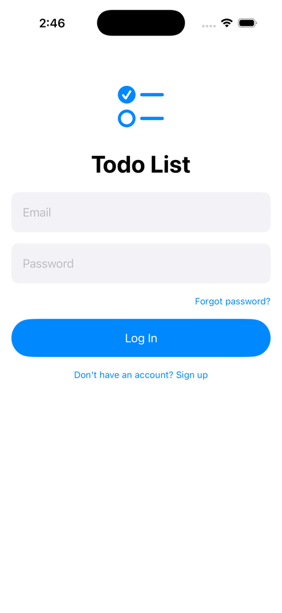
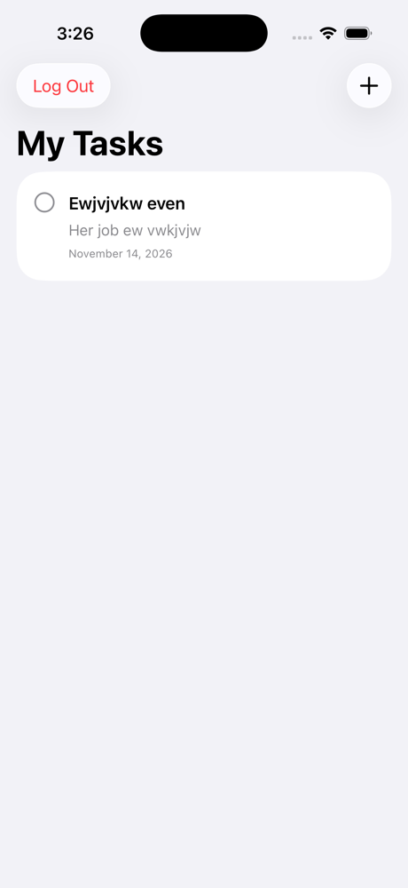
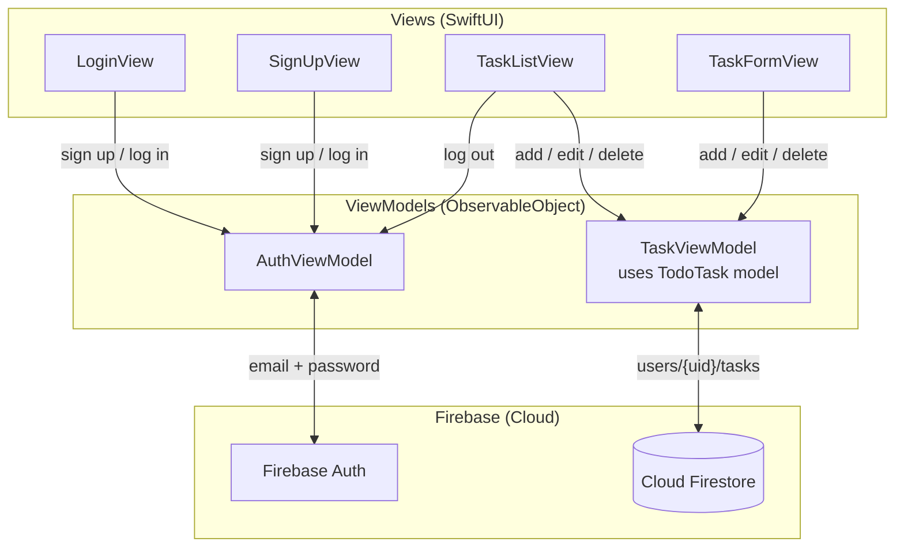
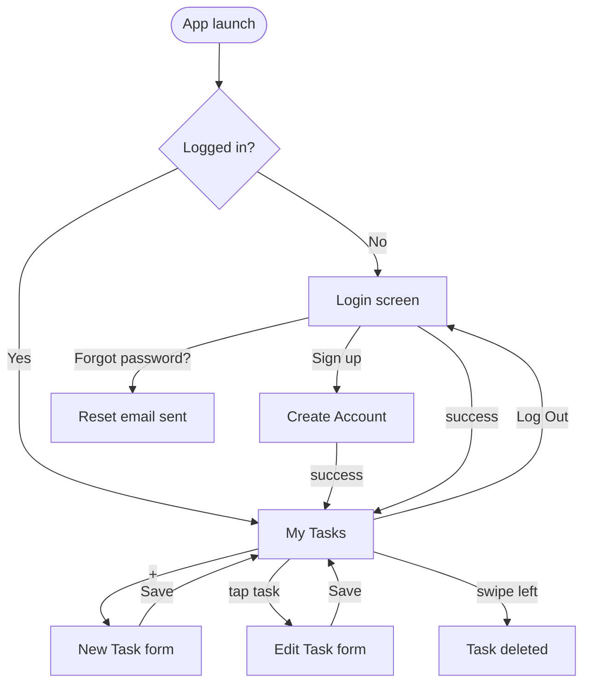
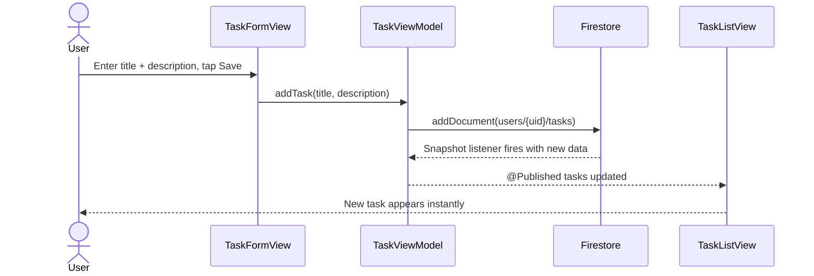
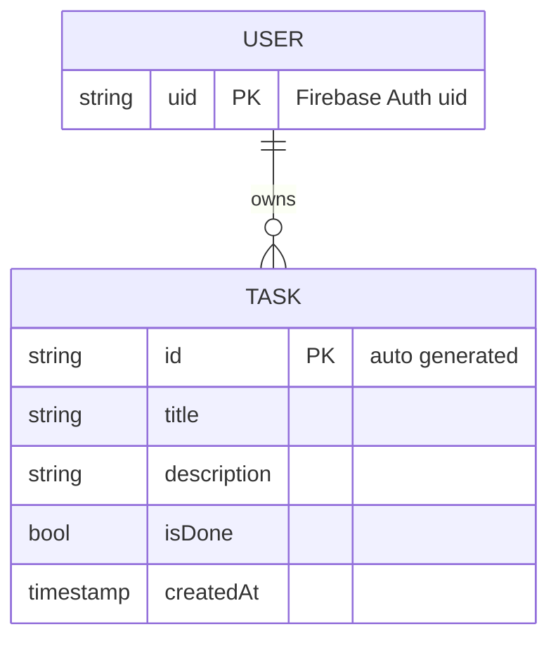

# Firebase Todo List (iOS)

A todo list app for iOS built with **SwiftUI**, **Firebase Authentication** and **Cloud Firestore**.
Every user signs in with email and password and gets their own private list of tasks that syncs in real time.

> Mobile Computing Lab Assignment · Muttakin · Roll 2207061

| Login | My Tasks |
| :---: | :---: |
|  |  |

| | |
|---|---|
| **Platform** | iOS 16+ (iPhone and iPad) |
| **Language / UI** | Swift 5, SwiftUI |
| **Architecture** | MVVM |
| **Backend** | Firebase Auth (email/password), Cloud Firestore |
| **Dependencies** | Firebase iOS SDK via Swift Package Manager |
| **Tools** | Xcode 16+, Firebase CLI |

---

## Features

**Authentication**
- Sign up with email, password and password confirmation
- Log in / log out (with a confirmation dialog)
- Forgot password: sends a reset link to the user's email
- Input validation (empty fields, minimum 6 character password) and readable error messages
- Stays logged in between app launches

**Tasks (CRUD)**

| Operation | How |
|---|---|
| **Create** | Tap `+`, enter a title and description, tap **Save** |
| **Read** | Tasks appear in a live list, newest first |
| **Update** | Tap a task to edit it, or tap the circle to mark it done |
| **Delete** | Swipe a task to the left |

Each task has a **title**, a **description**, a **done** flag and a **created date**.

---

## Architecture

The app follows **MVVM**. Views only display state and forward user actions. View models talk to Firebase and publish the results back to the views.



### Screen flow



### How a task is saved



---

## Firestore Data Model

Tasks are stored in a sub-collection under each user, so data is separated per user.



```
users/{uid}/tasks/{taskId}
    title:       "Finish lab report"
    description: "Mobile computing, Firebase todo app"
    isDone:      false
    createdAt:   November 14, 2026 at 3:25 PM
```

## Security Rules

[`firestore.rules`](firestore.rules) makes sure a user can only touch their own tasks:

- `read`, `delete`: only if `request.auth.uid == userId`
- `create`, `update`: same check, plus `title` must be a non-empty string, `description` a string and `isDone` a bool
- Everything else is denied

---

## Project Structure

```
FirebaseTodo/
├── FirebaseTodoApp.swift        # Entry point, calls FirebaseApp.configure()
├── FirebaseTodo.entitlements    # Keychain sharing (needed by Firebase Auth)
├── Models/
│   └── TodoTask.swift           # Codable task model
├── ViewModels/
│   ├── AuthViewModel.swift      # Sign up, log in, log out, password reset
│   └── TaskViewModel.swift      # Firestore CRUD + real-time listener
└── Views/
    ├── ContentView.swift        # Switches between login and task list
    ├── LoginView.swift
    ├── SignUpView.swift
    ├── TaskListView.swift       # List, swipe to delete, toggle done, log out
    └── TaskFormView.swift       # Shared form for add and edit
firestore.rules                  # Firestore security rules
firebase.json, .firebaserc       # Firebase CLI config for deploying rules
```

---

## Getting Started

`GoogleService-Info.plist` is **not** in this repo (it is in `.gitignore`). You need to connect the app to your own Firebase project.

### 1. Firebase project

1. Create a project in the [Firebase Console](https://console.firebase.google.com/).
2. **Add app → iOS** with bundle ID `com.shadowfax505.FirebaseTodo` (or change the bundle ID in Xcode to match yours).
3. Download `GoogleService-Info.plist` and put it in the `FirebaseTodo/` folder, next to `FirebaseTodoApp.swift`. Xcode picks it up automatically.
4. **Authentication → Sign-in method** → enable **Email/Password**.
5. **Firestore Database → Create database** (production mode).

### 2. Security rules

Paste [`firestore.rules`](firestore.rules) into **Firestore → Rules** and click **Publish**, or deploy with the Firebase CLI:

```bash
npm install -g firebase-tools
firebase login
firebase use <your-project-id>
firebase deploy --only firestore:rules
```

### 3. Run

1. Open `FirebaseTodo.xcodeproj` in Xcode 16 or newer.
2. Wait for Swift Package Manager to download the Firebase packages.
3. Pick an iPhone simulator and press **Run** (⌘R).

To run on a real iPhone, select your Apple ID team under **Signing & Capabilities**.

---

## Troubleshooting

| Problem | Fix |
|---|---|
| App crashes on launch with a `FirebaseApp` error | `GoogleService-Info.plist` is missing from `FirebaseTodo/` |
| "Missing or insufficient permissions" | Rules not published, or not logged in |
| "Wrong email or password." | Check credentials, or use **Forgot password?** |
| Sign up fails with "operation not allowed" | Email/Password is not enabled in Firebase Auth |
| "An error occurred when accessing the keychain" | Run from Xcode with signing enabled (the entitlements file must be included) |
| "No such module FirebaseAuth" | Wait for packages, or **File → Packages → Reset Package Caches** |
| Reset email not arriving | Check spam; the email only goes to addresses that have an account |
